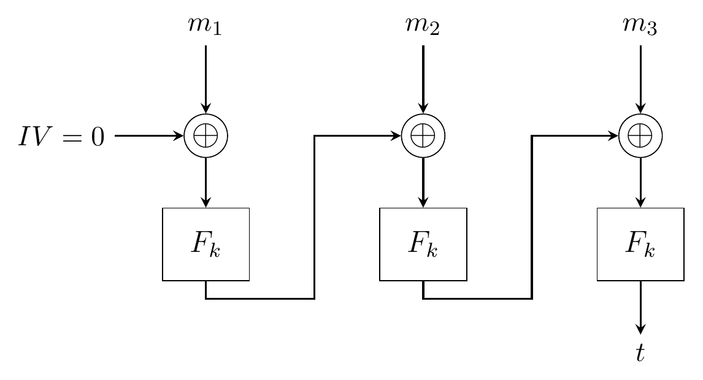
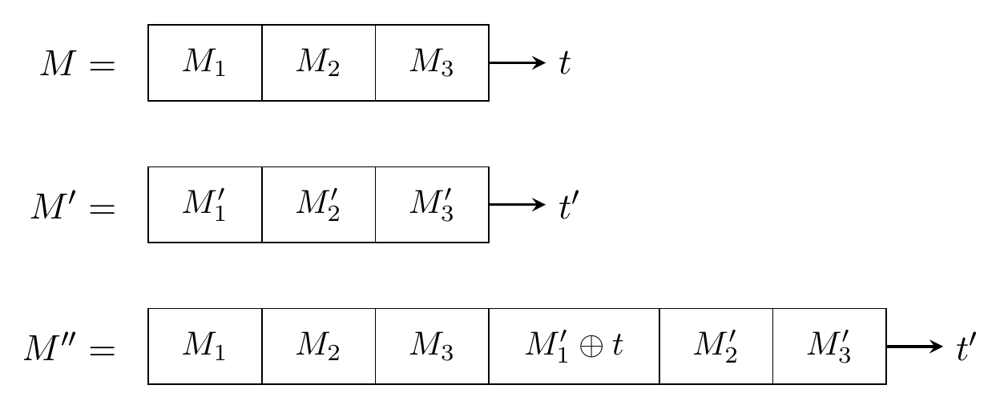
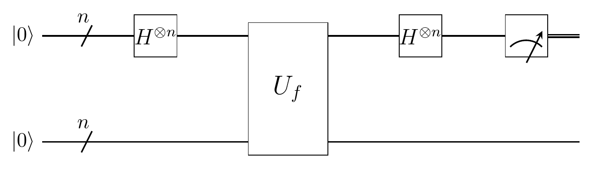
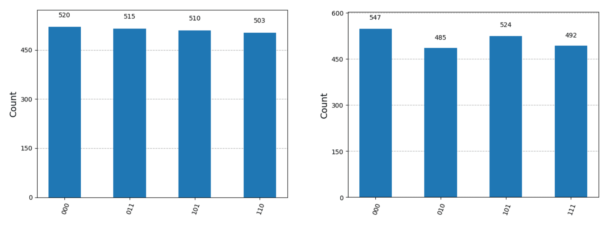
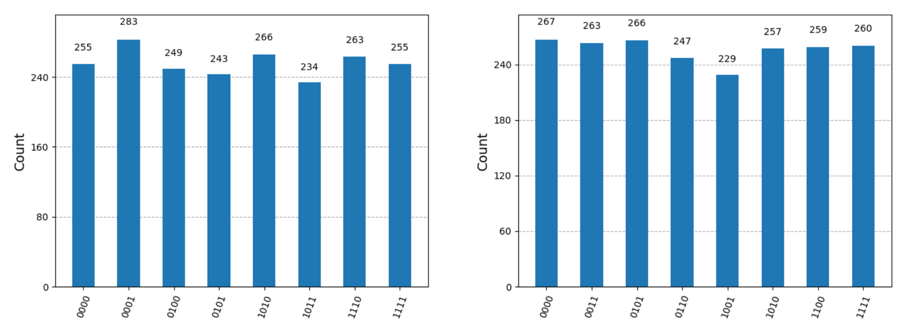
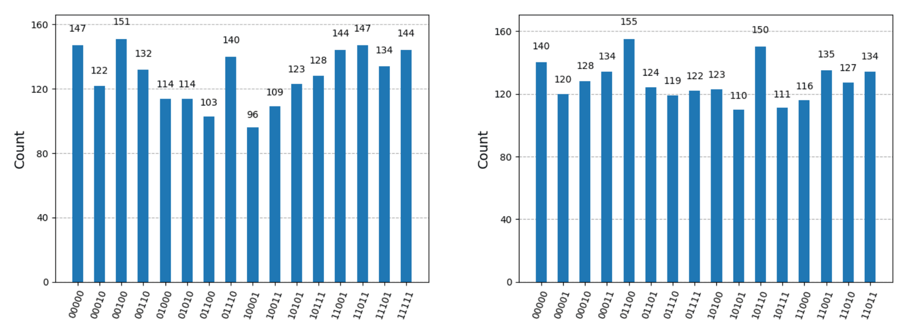
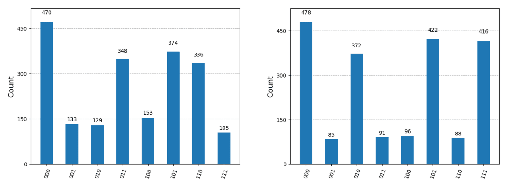
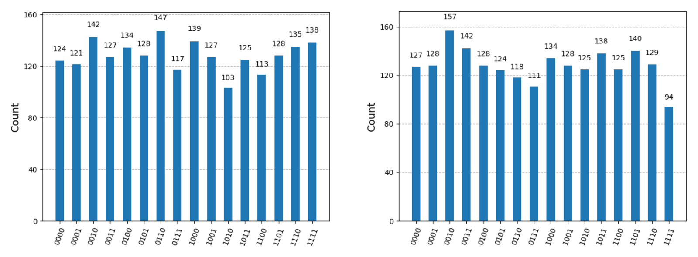
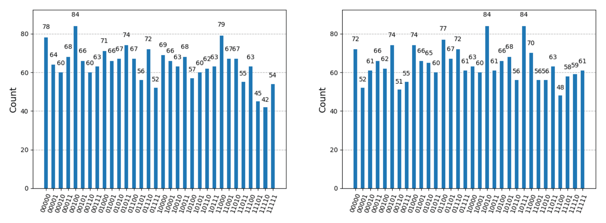

## Sommario

Il Cipher Block Chaining Message Authentication Code (CBC-MAC) è una tecnica per costruire un MAC a partire da un cifrario a blocchi. Anche se è dimostrato sicuro contro avversari classici quando la lunghezza dei messaggi è fissa, l'arrivo del calcolo quantistico minaccia seriamente queste garanzie. Partendo dai modelli teorici che sfruttano l'algoritmo di Simon per falsificazioni con prefisso scelto, questo studio traduce la crittoanalisi quantistica astratta in una pipeline funzionante ed eseguibile dall'inizio alla fine. Più precisamente, la nostra implementazione usa l'algoritmo di Simon all'interno di un modello di attacco quantistico a testo in chiaro scelto (qCPA), che permette di estrarre in modo artificiale i valori intermedi del MAC senza bisogno di richieste di lunghezza variabile.

Valutiamo questa pipeline di falsificazione sia su simulatori quantistici ideali (Qiskit Aer) sia su QPU reali (IQM Sirius). Mentre gli ambienti simulati confermano perfettamente l'attacco matematico, le esecuzioni sull'hardware reale mostrano un limite operativo netto. Dimostriamo che il rumore ambientale e il costo aggiuntivo della sintesi delle porte, propri delle architetture Noisy Intermediate-Scale Quantum (NISQ), neutralizzano di fatto l'attacco per configurazioni con blocchi più grandi di 2 bit. In definitiva, questo lavoro dimostra che, anche se oggi il rumore dell'hardware protegge la crittografia dai circuiti quantistici profondi, la vulnerabilità di fondo del CBC-MAC resta una minaccia critica, da affrontare prima dell'arrivo dei computer quantistici fault-tolerant.

## 1. Introduzione

### 1.1 CBC-MAC: basi classiche e vulnerabilità note

Il CBC-MAC è una tecnica consolidata per costruire un codice di autenticazione dei messaggi (MAC) a partire da un cifrario a blocchi. In una comunicazione tra due parti, garantisce che:

- il messaggio sia stato inviato da chi possiede la chiave segreta condivisa (**autenticazione**);
- il messaggio non sia stato modificato durante la trasmissione (**integrità**).

Il principio è semplice: si prende un messaggio, lo si divide in blocchi e si elabora ogni blocco, uno dopo l'altro, con un cifrario a blocchi (per esempio AES) in modalità CBC, con il vettore di inizializzazione (IV) uguale a zero. L'ultimo blocco cifrato è il tag del MAC.



Questo meccanismo garantisce l'autenticazione perché la funzione interna $F_k$ usa la chiave segreta condivisa $k$, e garantisce l'integrità perché l'ultimo blocco cifrato $t$ fa da impronta che permette di scoprire eventuali manomissioni.

È ben documentato che il CBC-MAC è vulnerabile già nel caso classico quando sono ammessi **messaggi di lunghezza variabile**. Supponiamo che un avversario abbia intercettato:

- $t$, il tag di un certo messaggio $M$;
- $t'$, il tag di un altro messaggio $M'$.

Con queste sole informazioni è possibile falsificare un nuovo messaggio $M''$ con un tag valido $t''$, senza conoscere la chiave segreta.



La contromisura classica standard è imporre rigidamente messaggi di lunghezza fissa quando si usa il CBC-MAC. Questo impedisce di calcolare $M''$, che altrimenti sarebbe più lungo sia di $M$ sia di $M'$.

**Nota:** è importante chiarire che la nostra implementazione presuppone messaggi di lunghezza fissa. L'attacco di falsificazione che descriviamo è impossibile con mezzi classici ed è una vulnerabilità esclusivamente quantistica.

### 1.2 qCPA: il modello di attacco

L'attacco descritto e implementato in questo progetto rientra nel modello di attacco quantistico a testo in chiaro scelto (qCPA, quantum Chosen-Plaintext Attack). In questo scenario, un avversario ha accesso a un oracolo che implementa il CBC-MAC. Il punto cruciale è che **l'avversario può interrogare l'oracolo non solo con input classici, ma anche con sovrapposizioni quantistiche di messaggi**. In pratica, può inviare all'oracolo qualsiasi sovrapposizione di messaggi e ottenere la corrispondente sovrapposizione di tag CBC-MAC.

L'obiettivo dell'attacco è intercettare un messaggio valido $M$ insieme al suo tag $t$ e poi manometterlo, costruendo un messaggio falsificato $M_f$ con un tag valido $t_f$.

**Un vincolo fondamentale è che l'avversario non può semplicemente chiedere all'oracolo il tag di $M_f$ per ottenere $t_f$ direttamente, perché questo renderebbe banale la falsificazione.** L'attacco ricava invece $t_f$ in modo indiretto, sfruttando la risposta dell'oracolo a messaggi diversi, scelti con cura, in sovrapposizione.

#### 1.2.1 Analisi del vantaggio quantistico

Per capire quanto sia grave questa minaccia, è fondamentale distinguere tra due paradigmi principali della crittoanalisi quantistica:

1. **Algoritmo di Grover: forza bruta offline.** Quando i crittografi valutano la minaccia quantistica contro cifrari a blocchi come AES, di solito considerano un attacco offline con l'algoritmo di Grover.
   - **Preparazione:** l'avversario intercetta una sola coppia classica testo in chiaro-testo cifrato.
   - **Esecuzione offline:** l'avversario costruisce sul proprio hardware un circuito quantistico dell'algoritmo crittografico. Con l'algoritmo di Grover cerca nello spazio delle chiavi, in sovrapposizione, la chiave che trasforma il testo in chiaro noto nel testo cifrato noto.
   - **Limiti:** poiché si tratta di una ricerca a forza bruta in uno spazio matematico senza struttura, che non richiede altre interazioni con il bersaglio, l'avversario ottiene solo un vantaggio quadratico ($\mathcal{O}(\sqrt{N})$). Di conseguenza basta raddoppiare la lunghezza della chiave classica per neutralizzare questa minaccia.
2. **Algoritmo di Simon: minaccia qCPA online.** L'algoritmo di Simon, invece, non cerca la chiave a forza bruta: individua schemi strutturali nascosti (periodicità) in una funzione, con un vantaggio esponenziale.
   - **Preparazione:** l'avversario non conosce la chiave segreta e quindi non può simulare il MAC in locale. Ha bisogno di poter interrogare il dispositivo bersaglio in funzione, che contiene la chiave al suo interno.
   - **Esecuzione online:** l'avversario invia direttamente al dispositivo bersaglio una sovrapposizione quantistica di messaggi diversi, e il dispositivo restituisce la corrispondente sovrapposizione di tag. Analizzando questi stati quantistici di ritorno, l'algoritmo di Simon svela le collisioni interne nascoste della struttura del CBC-MAC.

#### 1.2.2 Scenari realistici

Una critica frequente al modello qCPA è che un attaccante non può facilmente inviare stati quantistici a un dispositivo crittografico in funzione. Questo è vero per i normali server classici, ma il modello di minaccia diventa molto rilevante in due scenari specifici e rivolti al futuro:

- **Crittografia white-box (il nostro caso di studio):** nei sistemi moderni di gestione dei diritti digitali (DRM) o di pagamento da mobile, il software contiene spesso una chiave segreta simmetrica scritta nel codice e protetta tramite offuscamento: è la cosiddetta crittografia white-box. Un attaccante può estrarre questo codice classico offuscato e, con una procedura non banale, tradurlo in un circuito quantistico locale. Riconosciamo esplicitamente che, se un avversario ha analizzato un'implementazione white-box abbastanza a fondo da riuscirci, probabilmente ha già strade classiche più semplici per comprometterla. La nostra implementazione qCPA, però, mostra una vulnerabilità matematica fondamentale, che non si può correggere e che aggira completamente le contromisure classiche.
- **Reti quantistiche native:** la realizzazione a lungo termine della minaccia qCPA arriverà con l'internet quantistico, in cui dispositivi come router quantistici o smart card trasmetteranno ed elaboreranno qubit in modo nativo. Per garantire un instradamento sicuro, questi dispositivi useranno probabilmente crittografia simmetrica integrata nell'hardware. Poiché l'hardware è progettato apposta per ricevere stati quantistici, un avversario collegato alla rete può inviare con naturalezza una sovrapposizione di messaggi direttamente al modulo di autenticazione simmetrica del dispositivo. Il dispositivo, funzionando esattamente come previsto, elabora la sovrapposizione ed espone senza volerlo le sue periodicità interne all'algoritmo di Simon, senza che l'attaccante debba analizzare nulla a ritroso.

### 1.3 Obiettivo e lavori correlati

L'obiettivo principale di questo progetto è colmare la distanza tra la crittoanalisi quantistica teorica e l'ingegneria del software pratica.

In particolare, traduciamo le dimostrazioni matematiche di Santoli e Schaffner [1] in un circuito quantistico funzionante. Valutiamo questa implementazione non solo su un simulatore quantistico ma anche su hardware quantistico reale di IQM. Questa valutazione sperimentale vuole tracciare il confine tra i risultati teorici ottenibili con qubit logici e i vincoli pratici imposti dal rumore dell'hardware nei dispositivi quantistici di oggi.

Oltre al quadro di riferimento di Santoli e Schaffner, la nostra realizzazione si basa sulle tecniche di crittoanalisi quantistica introdotte da Kuwakado e Morii [2]. Il contesto generale sul calcolo quantistico viene invece dal lavoro di Nielsen e Chuang [3].

## 2. Quadro teorico: la matematica

### 2.1 Descrizione dello scenario

Consideriamo uno scenario di comunicazione tra due parti, Alice e Bob, che vogliono scambiarsi un messaggio garantendo autenticazione e integrità con il CBC-MAC. Una terza parte, Charlie, è un avversario in posizione Man-In-The-Middle (MITM). Charlie cerca di manomettere il messaggio inviato da Alice e di inoltrarlo a Bob in modo che Bob non si accorga della modifica.


### 2.2 L'algoritmo di Simon (elaborazione quantistica)

L'algoritmo di Simon è una subroutine quantistica pensata per risolvere il problema di Simon. Formalmente, sia

$$
f : \{0,1\}^n \to \{0,1\}^m, \quad m \geq n
$$

una funzione con questa promessa: esiste una stringa segreta $s \in \{0,1\}^n$ tale che, per ogni coppia di elementi distinti $x, y \in \{0,1\}^n$,

$$
f(x) = f(y) \quad \text{se e solo se} \quad y = x \oplus s.
$$

Il problema chiede di ricavare la stringa nascosta $s$, avendo accesso a un oracolo che implementa $f$.

L'algoritmo di Simon risolve il problema con solo $\mathcal{O}(n)$ interrogazioni all'oracolo, mentre il miglior algoritmo classico noto ne richiede almeno $\mathcal{O}(2^{n/2})$.



**Procedura ad alto livello.** L'algoritmo procede in due fasi principali:

1. Si esegue la **subroutine quantistica** di Simon circa $n$ volte, per ottenere un insieme di stringhe di bit $y$ linearmente indipendenti e ortogonali a $s$ (cioè $y \cdot s = 0$, dove $\cdot$ indica il prodotto scalare bit a bit modulo 2).
2. Si risolve in modo classico il sistema di equazioni lineari che ne risulta, per ricavare la stringa nascosta $s$.

**Subroutine quantistica.** Di solito la subroutine quantistica ([Figura 4](#simon-subroutine)) si descrive in cinque passi, ma nella nostra implementazione pratica è ottimizzata a quattro. Grazie al principio della misura differita omettiamo la misura intermedia del registro di uscita, riducendo così il rumore e la decoerenza sul dispositivo di IQM:

1. **Sovrapposizione:** si applicano porte di Hadamard a tutti i qubit del registro di ingresso, creando una sovrapposizione uniforme di tutti gli $x \in \{0,1\}^n$.
2. **Interrogazione dell'oracolo:** si interroga l'oracolo che implementa l'operatore unitario $U_f$, che entangla i registri trasformando $\ket{x}\ket{0}$ in $\ket{x}\ket{f(x)}$.
3. **Interferenza:** si applicano di nuovo porte di Hadamard al registro di ingresso. Poiché gli stati $\ket{x}$ e $\ket{x \oplus s}$ sono entanglati con lo stesso stato di uscita $\ket{f(x)}$, interferiscono direttamente. Questa interferenza distruttiva elimina del tutto gli stati non ortogonali a $s$.
4. **Misura:** si misura il registro di ingresso e si ottiene una stringa di bit casuale $y$ che soddisfa esattamente $y \cdot s = 0$. Il registro di uscita viene tracciato via (ignorato), perché misurarlo non è matematicamente necessario perché avvenga l'interferenza.

### 2.3 L'attacco di falsificazione qCPA (sintesi quantistica)

Consideriamo un messaggio $M$ diviso in $N$ blocchi. Senza perdita di generalità ignoriamo le tecniche di padding e supponiamo che il messaggio si divida esattamente in $N$ parti uguali:

$$
M := M_1 \,\|\, M_2 \,\|\, \dots \,\|\, M_N.
$$

I passi dell'attacco quantistico di falsificazione sono questi:

1. **Fissare un prefisso $\alpha_1$:** si sceglie un prefisso di $P$ blocchi del messaggio originale $M$. Il nostro algoritmo lascia questo prefisso del tutto invariato: si falsifica solo la parte restante del messaggio.
2. **Scegliere un prefisso arbitrario $\alpha_0$:** si sceglie un prefisso $\alpha_0$ diverso, con esattamente lo stesso numero di blocchi di $\alpha_1$.
3. **Ottenere un tag valido $t_f$:** si chiede all'oracolo classico un tag valido per un messaggio completato interamente con blocchi di zeri. Se la lunghezza totale del messaggio $N$ è dispari, si chiede:
   $$
   M_1 := \alpha_1 \,\|\, 0 \,\|\, \dots \,\|\, 0
   $$
   Se la lunghezza totale del messaggio $N$ è pari, si chiede:
   $$
   M_0 := \alpha_0 \,\|\, 0 \,\|\, \dots \,\|\, 0
   $$
4. **Calcolare i blocchi sostitutivi $z_j$:** usando l'algoritmo di Simon per estrarre le periodicità nascoste, si calcolano i blocchi falsificati $z_j$ con la relazione:
   $$
   z_j := \pi^j(\alpha_0) \oplus \pi^j(\alpha_1)
   $$
   per tutti i blocchi restanti $j \in \{P+1, \dots, N\}$, dove $\pi^j$ indica la permutazione del cifrario a blocchi applicata $j$ volte di seguito.
5. **Sintetizzare il messaggio falsificato:** si sostituisce ogni blocco originale $M_j$ con il blocco calcolato $z_j$ corrispondente.

Il risultato è un messaggio completamente falsificato $M_f$:

$$
M_f := \alpha_1 \,\|\, z_1 \,\|\, z_2 \,\|\, \dots \,\|\, z_{N-P}
$$

che si abbina perfettamente al tag valido $t_f$ ottenuto al passo 3.

**Nota:** è fondamentale sottolineare che **il passo 4 è l'unica parte della procedura che richiede calcolo quantistico**. Tutti gli altri passi vengono eseguiti su hardware classico.

## 3. Implementazione e progetto del circuito (il codice)

Il codice sorgente completo è pubblico sia su [GitHub](https://github.com/kevin-intelisano/nisq-cbc-mac-attack) sia su [Codeberg](https://codeberg.org/kevin-intelisano/nisq-cbc-mac-attack).

### 3.1 Architettura del software

Il progetto è stato sviluppato interamente in Python con i Jupyter Notebook e si basa sul framework Qiskit sia per costruire sia per eseguire i circuiti quantistici. I calcoli sono stati fatti in due ambienti distinti: le simulazioni locali senza rumore con il simulatore Qiskit Aer, mentre gli esperimenti quantistici reali sono stati eseguiti direttamente sull'hardware IQM Sirius, con l'autenticazione tramite token dell'API.

Il codice è organizzato in diversi moduli distinti, ciascuno con un compito ben definito:

- `bitblock`: definisce la struttura dati di base per rappresentare stringhe binarie di lunghezza fissa. Queste istanze sono le unità elementari per messaggi, chiavi e qualsiasi altro blocco di bit nei calcoli del CBC-MAC. La classe garantisce la correttezza dei dati (accetta solo array di interi 0 o 1 e mantiene una lunghezza di blocco definita) e offre utili operazioni di basso livello come lo XOR bit a bit, l'assegnazione di un blocco (`equal`) o la conversione in decimale (`toDecimal`).
- `cipher_switch` (con gli oracoli `cipher_TRNG` e `cipher_SDES`):
  - `cipher_switch`: fa da livello di astrazione crittografica dinamico e da interfaccia verso l'oracolo. Uniforma l'inizializzazione dello stato del cifrario, la costruzione degli operatori dell'oracolo quantistico e la generazione dei tag CBC-MAC classici, così il programma può passare da un algoritmo di cifratura a un altro senza toccare la logica centrale dell'attacco.
  - `cipher_TRNG`: emula un cifrario a sostituzione puramente casuale, basato su una tabella in memoria, generando una tabella di permutazione mescolata su tutto lo spazio dei blocchi.
  - `cipher_SDES`: implementa l'algoritmo classico Simplified Data Encryption Standard (S-DES), limitando le operazioni a blocchi di 8 bit.
- `simon`: è il motore di esecuzione quantistica del progetto. Questo modulo costruisce dinamicamente il circuito quantistico necessario per applicare l'algoritmo di Simon all'oracolo e scoprire le periodicità nascoste. Mappa i prefissi del messaggio ($\alpha_0$ e $\alpha_1$) nei registri quantistici, inserisce le porte unitarie $U_\pi$ per simulare il CBC-MAC in sovrapposizione ed esegue i phase kickback e le misure necessari. Questa libreria gestisce anche la scelta dell'ambiente di esecuzione: la simulazione locale senza rumore con Qiskit Aer oppure l'esecuzione su unità di elaborazione quantistica reali tramite il provider dell'hardware IQM.
- `attack`: è il livello che contiene la logica dell'avversario. Coordina l'attacco quantistico a testo in chiaro scelto (qCPA) e nasconde i dettagli della meccanica quantistica al flusso principale del programma. Prepara le variabili di ingresso, generando una copia del prefisso ($\alpha_1$) e una sua controparte con un bit invertito ($\alpha_0$), e ottiene dall'oracolo classico il tag falsificato. Poi richiama più volte il modulo `simon` per calcolare le stringhe di bit ($z_j$) che servono a falsificare, uno dopo l'altro, i blocchi restanti del messaggio originale.
- `main`: il programma che guida la simulazione e coordina lo scenario Man-in-the-Middle (MitM). Stabilisce i parametri globali (descritti sotto) e simula i tre attori: Alice (la sorgente, che genera un messaggio valido e il suo tag), Charlie (l'avversario, che intercetta la comunicazione e usa il modulo `attack` per manipolare il contenuto) e Bob (la destinazione, che riceve i dati manomessi e accetta o rifiuta il messaggio).

### 3.2 Il circuito quantistico passo per passo

Fin dall'inizio, il nostro approccio di progetto ha voluto che i parametri crittografici principali si potessero cambiare senza modificare il codice. Lo script `main` permette di controllare nel dettaglio la configurazione con questi dizionari e variabili:

- `BLOCK_SIZE`, `MESSAGE_LENGTH`, `PREFIX_LENGTH`: definiscono le dimensioni dell'attacco, cioè il numero di bit di ogni blocco, il numero totale di blocchi del messaggio intercettato e la lunghezza del prefisso fisso.
- `CIPHER_OPTIONS`: stabilisce il cifrario bersaglio (per esempio TRNG o SDES) e le sue caratteristiche.
- `SIMULATION_OPTIONS`: sceglie se eseguire in simulazione locale o sull'hardware reale di IQM. Gestisce anche le variabili di esecuzione, come il numero di ripetizioni (`SHOTS`), la visualizzazione dei grafici diagnostici e delle metriche di prestazione, la gestione sicura del token di autenticazione di IQM e l'indirizzo del servizio.

Per rendere la discussione concreta e riproducibile, riportiamo i parametri esatti usati nel nostro codice. Con questi valori il lettore può riprodurre esattamente la generazione del circuito.

```python
# Message options
BLOCK_SIZE = 4      # >= 2
MESSAGE_LENGTH = 3  # >= 3
PREFIX_LENGTH = 1   # <= MESSAGE_LENGTH - 2

CIPHER_OPTIONS = {
    'NAME': 'TRNG',
    'FIXED_PI': True
}
SIMULATION_OPTIONS = {
    'SIMULATED': True,
    'SHOTS': 2048,
    'DETAILS': True,
    'PRIVATE_TOKEN': os.getenv('IQM_TOKEN'),
    'IQM_URL': 'https://resonance.iqm.tech/sirius'
}

message = [
    Block(BLOCK_SIZE, [0, 0, 0, 1]),
    Block(BLOCK_SIZE, [1, 0, 0, 0]),
    Block(BLOCK_SIZE, [0, 1, 0, 0])
]
```

Prima di esaminare i circuiti quantistici generati, è necessario chiarire alcune premesse fondamentali sulla loro logica:

1. **Il ruolo del cifrario e dei prefissi:** il risultato della falsificazione quantistica dipende solo dal **cifrario scelto**, dal prefisso originale $\boldsymbol{\alpha_1}$ (il primo blocco del messaggio) e dalla sua controparte quantistica $\boldsymbol{\alpha_0}$ (che è semplicemente $\alpha_1$ con il primo bit negato). Il contenuto esatto di tutti i blocchi successivi del messaggio è del tutto irrilevante per l'estrazione matematica della stringa nascosta.
2. **Notazione dei registri:** indichiamo semplicemente con $\alpha$ il registro quantistico formato dai fili $alpha_0, alpha_1, alpha_2, alpha_3$, e con $x$ il registro di ingresso formato dai fili $x_0, x_1, x_2, x_3$.
3. **Ordine dei bit:** Qiskit associa il bit meno significativo (LSB) al qubit con l'indice più basso (il filo in alto nel disegno del circuito). Per esempio, nella [Figura 5](#forgery-circuit), inizializzare il registro $\alpha$ con la stringa binaria 0001 (dove l'LSB è 1) mette un 1 sul filo in alto ($alpha_0$) e degli 0 sui fili sotto. Leggendo dall'alto in basso, si vede 1000.

L'esempio che segue mostra la procedura di falsificazione quantistica. In particolare, descrive l'estrazione del blocco falsificato che sostituisce il blocco originale del messaggio $[1, 0, 0, 0]$.


#### 3.2.1 Prima fase: inizializzazione di α₁ e α₀

Il circuito comincia (prima della prima barriera) preparando i registri quantistici $b$ e $\alpha$. Il qubit di controllo $b$ viene messo in sovrapposizione con una porta di Hadamard e serve a entanglare i due prefissi distinti, $\alpha_1$ e $\alpha_0$. Nella [Figura 5](#forgery-circuit) questo si vede così:

- $\alpha_1 = [0001]$, ottenuto applicando una porta X al filo $alpha_0$;
- $\alpha_0 = [1001]$, ottenuto applicando una porta CNOT controllata da $b$ con bersaglio il filo $alpha_3$ (l'MSB). Questa porta inverte il bit bersaglio quando $b = 1$ e lo lascia invariato altrimenti.

Il risultato di questa procedura è che **il registro $\boldsymbol{\alpha}$ ora contiene contemporaneamente sia $\boldsymbol{\alpha_0}$ sia $\boldsymbol{\alpha_1}$ in sovrapposizione**. Questa fase prepara lo stato di partenza che serve all'oracolo quantistico successivo.

#### 3.2.2 Seconda fase: la sovrapposizione di Simon e l'unitario del CBC-MAC

Dopo la prima barriera, si applicano porte di Hadamard al registro $x$ per creare la sovrapposizione uniforme richiesta dall'algoritmo di Simon. Poi si costruisce l'operatore unitario della funzione CBC-MAC modificata:

$$
\begin{aligned}
g_j &: \{0,1\}^{n+1} \to \{0,1\}^n, \\
b \,\|\, x &\mapsto \mathrm{CBC}^{\ell}_{\pi}\left(\alpha_b \,\|\, 0^{(j-1)n} \,\|\, x \,\|\, 0^{(\ell-j-1)n}\right) = \pi^{\ell-j}\left(\pi^j(\alpha_b) \oplus x\right).
\end{aligned}
$$

Questa struttura matematica corrisponde esattamente alla sequenza di porte del circuito. In questa esecuzione stiamo estraendo il blocco $z_1$ da un messaggio di lunghezza $\ell = 3$, quindi $j = 1$.

- $\pi^j(\alpha_b)$: il circuito applica esattamente un blocco `U_TRNG` al registro $\alpha$.
- $\oplus\, x$: il registro di ingresso $x$ viene sommato con lo XOR in $\alpha$ tramite una sequenza di porte CNOT.
- $\pi^{\ell-j}$: poiché $\ell - j = 2$, il circuito applica esattamente altri due blocchi `U_TRNG` al registro $\alpha$.

Questo passo è la chiave per estrarre la periodicità promessa, che finisce nella fase del registro di ingresso combinato ($b \,\|\, x$). **Con mezzi classici, ottenere questa informazione strutturale richiederebbe di applicare la funzione CBC-MAC a messaggi sempre più lunghi, violando così l'ipotesi di lunghezza fissa su cui si basa la sicurezza del protocollo.**

#### 3.2.3 Terza fase: interferenza e misura finale

Dopo l'ultima barriera, il circuito si conclude applicando porte di Hadamard al registro di ingresso combinato (formato da $x$ e $b$). Questa operazione produce un'interferenza distruttiva, dovuta alla stringa nascosta $s$ codificata nella fase.

Sopravvivono a questa interferenza solo le stringhe di bit $y$ **ortogonali** a $s$ (cioè quelle con $y \cdot s = 0$). Misurando i fili $x$ e $b$ nel registro classico `result` si ottiene una stringa di bit casuale, uniforme tra quelle ortogonali a $s$. Ripetendo la procedura più volte, **si può accumulare un sistema di equazioni lineari indipendenti, che si risolve in modo classico per ricavare la stringa nascosta $s$**.

## 4. Valutazione

In questa sezione valutiamo le prestazioni sperimentali della nostra pipeline di circuiti quantistici, confrontando un ambiente di simulazione ideale con un'unità di elaborazione quantistica reale.

In tutte le valutazioni sperimentali presentate qui, gli esperimenti sono stati eseguiti con una lunghezza del messaggio fissata a 3 blocchi. Abbiamo fatto variare in modo sistematico la dimensione dei blocchi tra $\{2, 3, 4\}$ bit, per isolare con precisione il rapporto tra dimensione crittografica, numero di porte e soglie di decoerenza dell'hardware. Come già detto nella sezione 3.2, il contenuto esatto dei blocchi del messaggio che seguono il prefisso è irrilevante e non influisce sul risultato della falsificazione. Per riprodurre i nostri risultati, quindi, i prefissi sono definiti così:

- blocchi da 2 bit: $\alpha_1 = [0, 1]$
- blocchi da 3 bit: $\alpha_1 = [0, 0, 1]$
- blocchi da 4 bit: $\alpha_1 = [0, 0, 0, 1]$

### 4.1 Verifica teorica con il simulatore

Per verificare la correttezza matematica della nostra costruzione modulare del circuito, le prime prove sono state fatte con il **simulatore Qiskit Aer**. In queste condizioni ideali, senza rumore, il circuito si comporta esattamente come promette la teoria di Simon, qualunque siano la dimensione dei blocchi, la lunghezza del messaggio, la lunghezza del prefisso o il cifrario scelto.







Come si vede nelle [Figure 6](#aer-2-bit), [7](#aer-3-bit) e [8](#aer-4-bit), per ogni configurazione dei blocchi (che dà rispettivamente 8, 16 e 32 risultati di misura matematicamente possibili nel registro di ingresso combinato), i risultati si limitano esattamente alla metà delle stringhe di bit possibili.

Questo risultato conferma che il meccanismo di phase kickback produce davvero l'interferenza distruttiva, cancellando perfettamente tutte le componenti dello stato che non soddisfano la condizione di ortogonalità $y \cdot s = 0$.

In pratica, per ricavare la stringa segreta $s$ si può risolvere formalmente il sistema di equazioni lineari che viene da questi risultati ortogonali. In alternativa, visto che i dati simulati sono puliti, si possono individuare i vettori di base direttamente dai conteggi (in particolare le stringhe di bit con peso di Hamming 2 e bit più significativo uguale a 1). Applicando una maschera di OR logico a questi vettori si ottiene, in modo efficiente e preciso, il blocco nascosto $z_j$ di quella iterazione.

### 4.2 Esecuzione reale (hardware IQM)

Quando gli stessi circuiti vengono eseguiti sull'hardware reale con il backend **IQM Sirius**, l'esecuzione incontra una barriera di rumore notevole. Al crescere dei parametri, i risultati sull'hardware reale peggiorano rapidamente, a causa del costo aggiuntivo della sintesi delle porte e della decoerenza.







Come si vede nelle [Figure 10](#sirius-3-bit) e [11](#sirius-4-bit), aumentando la dimensione dei blocchi l'istogramma perde del tutto la sua struttura e diventa una distribuzione uniforme, in cui compaiono tutte le stringhe di bit matematicamente possibili. Al contrario, la configurazione con blocchi da 2 bit ([Figura 9](#sirius-2-bit)) è l'unica che mantiene un rapporto segnale-rumore sufficiente per ricavare in modo affidabile l'informazione nascosta, perché il salto tra le stringhe ortogonali valide e gli artefatti del rumore resta netto.

Per capire questo crollo con blocchi più grandi, bisogna guardare le metriche di transpilazione delle Tabelle 1, 2 e 3.

| Metrica/porta | Astratto | Transpilato | Differenza |
| --- | --: | --: | --: |
| Profondità | 8 | 28 | +20 |
| Dimensione totale | 16 | 44 | +28 |
| CX | 3 | 0 | −3 |
| CZ | 0 | 7 | +7 |
| SWAP | 0 | 14 | +14 |
| H | 6 | 0 | −6 |
| X | 1 | 0 | −1 |
| R | 0 | 20 | +20 |
| $U_\pi$ | 3 | 0 | −3 |
| Barriere | 4 | 4 | +0 |
| Misure | 3 | 3 | +0 |

*Tabella 1: metriche di transpilazione su IQM Sirius, blocchi da 2 bit.*

| Metrica/porta | Astratto | Transpilato | Differenza |
| --- | --: | --: | --: |
| Profondità | 8 | 182 | +174 |
| Dimensione totale | 20 | 269 | +249 |
| CX | 4 | 0 | −4 |
| CZ | 0 | 60 | +60 |
| SWAP | 0 | 102 | +102 |
| H | 8 | 0 | −8 |
| X | 1 | 0 | −1 |
| R | 0 | 103 | +103 |
| $U_\pi$ | 3 | 0 | −3 |
| Barriere | 4 | 4 | +0 |
| Misure | 4 | 4 | +0 |

*Tabella 2: metriche di transpilazione su IQM Sirius, blocchi da 3 bit.*

| Metrica/porta | Astratto | Transpilato | Differenza |
| --- | --: | --: | --: |
| Profondità | 8 | 994 | +986 |
| Dimensione totale | 24 | 1427 | +1403 |
| CX | 5 | 0 | −5 |
| CZ | 0 | 303 | +303 |
| SWAP | 0 | 576 | +576 |
| H | 10 | 0 | −10 |
| X | 1 | 0 | −1 |
| R | 0 | 543 | +543 |
| $U_\pi$ | 3 | 0 | −3 |
| Barriere | 4 | 4 | +0 |
| Misure | 5 | 5 | +0 |

*Tabella 3: metriche di transpilazione su IQM Sirius, blocchi da 4 bit.*

Confrontando le distribuzioni sperimentali con queste metriche di transpilazione, si vede con precisione come il rumore renda i risultati via via inutilizzabili. A causa della topologia limitata dell'hardware, portare gli operatori unitari astratti sui qubit fisici richiede moltissime porte SWAP e un grande lavoro di instradamento. A partire da una profondità del circuito di circa 180 e da una dimensione totale di quasi 270 porte (come nella configurazione con blocchi da 3 bit), il rumore fisico accumulato diventa troppo alto per estrarre informazioni valide, e seppellisce di fatto la firma matematica della periodicità nascosta.

## 5. Conclusioni

In questo studio abbiamo colmato la distanza tra la crittoanalisi quantistica teorica e l'ingegneria dell'hardware reale, implementando dall'inizio alla fine una pipeline di falsificazione con attacco quantistico a testo in chiaro scelto (qCPA) contro un CBC-MAC con messaggi di lunghezza fissa.

Oltre alla verifica teorica, questo progetto ha un valore didattico importante: **rende comprensibili vulnerabilità quantistiche astratte, traducendo dimostrazioni matematiche in codice funzionante ed eseguibile**. La nostra implementazione mostra un uso molto particolare della subroutine di Simon. Invece di cercare una chiave nascosta globale, l'attacco costruisce in modo artificiale una struttura periodica e usa l'entanglement per "fotografare" il valore nascosto a una certa iterazione dell'operatore unitario del CBC-MAC. Questo approccio aggira i vincoli classici e permette di accedere ai valori intermedi dello stato anche quando tutti i messaggi hanno lunghezza rigorosamente fissa.

Le nostre valutazioni sull'hardware reale di IQM mettono però in evidenza i limiti attuali dell'era NISQ. Le prestazioni pratiche di questo attacco sono fortemente limitate dal rumore e dalla decoerenza dell'hardware. Quando un circuito arriva a circa 100 operazioni, il rumore ambientale e il costo aggiuntivo della compilazione rimescolano completamente il vettore di stato.

Anche se le nostre prove sull'hardware reale usano cifrari a blocchi ridotti per restare trattabili, l'esplosione esponenziale delle porte SWAP e del lavoro di instradamento, già evidente passando da blocchi di 2 a blocchi di 4 bit, indica chiaramente che portare questo attacco qCPA a cifrari usati in produzione (per esempio AES-128) è assolutamente impossibile con l'hardware di oggi. Servirebbero profondità di circuito di ordini di grandezza superiori ai tempi di coerenza attuali, il che rafforza la nostra conclusione: le architetture fault-tolerant sono un prerequisito fondamentale per questa minaccia.

Nonostante questi limiti fisici attuali, il modello teorico della minaccia resta molto rilevante. Come discusso nella sezione 1 a proposito degli scenari realistici, queste vulnerabilità sono molto generalizzabili. **Qualsiasi implementazione crittografica white-box potrebbe cadere vittima di questo attacco**, a patto che un avversario riesca a estrarre la funzione matematica offuscata e a compilarla in un circuito quantistico locale. Inoltre, nelle future **reti quantistiche native** questo vettore di attacco diventa del tutto immediato. Hardware progettato apposta per instradare ed elaborare stati quantistici elaborerà, senza volerlo, sovrapposizioni ostili esattamente come previsto, esponendo passivamente le sue periodicità interne all'algoritmo di Simon.

Storicamente la sicurezza crittografica si basa su una non linearità complessa per resistere agli attaccanti classici: una proprietà che, senza volerlo, produce circuiti quantistici profondi, intricati e quindi rumorosi. Oggi questo rumore dell'hardware fa da scudo temporaneo contro gli attacchi quantistici. Non dobbiamo però scambiare questo limite fisico per sicurezza matematica.

Man mano che l'industria passerà a computer quantistici fault-tolerant, dotati di qubit logici, le barriere fisiche che oggi impediscono queste vulnerabilità esponenziali spariranno. La vulnerabilità del CBC-MAC è un avvertimento serio: i progettisti quantistici e gli architetti di rete di domani dovranno procedere con estrema cautela.

**Dobbiamo anticipare e mitigare fin da oggi questi modelli di minaccia radicalmente nuovi, perché le infrastrutture digitali su cui si basa tutto non restino completamente indifese nell'era post-quantistica.**

## Bibliografia

1. Thomas Santoli e Christian Schaffner. Using Simon's algorithm to attack symmetric-key cryptographic primitives. *Quantum Information & Computation*, 17(1–2):9–12, 2017. [arXiv:1603.07856](https://arxiv.org/abs/1603.07856).
2. Hidenori Kuwakado e Masakatu Morii. Quantum distinguisher between the 3-round Feistel cipher and the random permutation. In *2010 IEEE International Symposium on Information Theory*, pagine 2682–2685. IEEE, 2010.
3. Michael A. Nielsen e Isaac L. Chuang. *Quantum Computation and Quantum Information*. Cambridge University Press, 2000.
